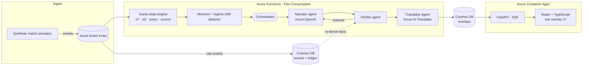

<div align="center">

# Momentum Ledger

**Verified, personalized match intelligence for live football broadcasts**

Measures how much every moment changes a match · explains why it matters ·
**proves every claim against the raw event ledger before it goes on screen** ·
tells the story differently for every fan, in any language.

*Built for **Inside the Game: Developer Hackathon** (Microsoft × Premier League)*
*Challenge: The Synthetic Match Insights Engine for Premier League Studio*

`Python 3.11+` · `FastAPI` · `React 19` · `TypeScript` · `Vite` · `Azure OpenAI` · `Azure AI Translator` · `Event Hubs` · `Functions` · `Cosmos DB` · `Container Apps`

</div>

---

## Contents

1. [The problem](#the-problem)
2. [What it does](#what-it-does)
3. [How verification works](#how-verification-works)
4. [Architecture](#architecture)
5. [Repository structure](#repository-structure)
6. [Quick start](#quick-start)
7. [Running on Azure](#running-on-azure)
8. [API reference](#api-reference)
9. [Overlay format](#overlay-format)
10. [Performance](#performance)
11. [Testing](#testing)
12. [Data](#data)

---

## The problem

Live AI commentary is powerful, but a broadcaster can't risk it on air. **One invented stat** ("his 4th goal of the season" when it's his 3rd) on a live broadcast damages trust. Most match-data tools also report *what* happened, not *why it mattered*, and every viewer gets the same experience.

## What it does

One pipeline, five stages:

| Stage | What happens |
|---|---|
| **1. Ingest** | A stochastic simulator streams football-realistic events: passes, carries, shots, tackles, interceptions, pressures, possession changes, substitutions and metadata. Each team's tactical **style** (possession, low block, high press) shapes the event patterns, so tactical shifts emerge from the data. |
| **2. Interpret** | A live game-state engine gives every event a measured value: expected threat (xT) added, xG, danger removed, lines broken, pass difficulty, ball and shot speed, press height, control vs. chaos, and momentum. |
| **3. Explain** | Instead of narrating every touch, it surfaces the **moments that changed the game** and the **points where the game changed character** (regime shifts in control and press), detected from data alone. |
| **4. Verify and render** | Every claim is checked against the ledger before air. Output is timecoded, machine-readable overlay JSON with graphic template, priority and duration, rendered live in the web app. |
| **5. Personalize** | **Casual** or **Analyst** mode · **club framing** ("good news for Riverside fans" vs. "danger for Northbridge") · **Player Lens** · **Catch Me Up** (a ranked recap from your side, not a chronological log) · **any language** (English, Spanish and Swahili offline; more with Azure Translator). |

### The demo match tells a story that was never scripted as events

The seed-7 match has a dominant home first half, then the away side switches to a high press just before the hour, and a late comeback follows (1-0 → 1-2). **The style switch is never emitted as an event.** The engine discovers it:

> **62' · Tactical shift**: Riverside Athletic press up 36 m (25 → 61 m from own goal) · Northbridge FC passes per possession 8.3 → 4.2 over the last 8

## How verification works

An insight is never prose. It's a set of **facts**, and every fact carries the **ledger query that proves it**:

```json
{ "key": "passes_recent", "value": 4.2, "display": "4.2",
  "query": { "op": "poss_passes_mean", "side": "home", "t1": 3660.0, "last_n": 8 } }
```

The **Verifier agent** checks every line before it can go to air:

| Check | Rule |
|---|---|
| **Fact audit** | Re-runs every fact's query against the raw events, through code that is independent of the live engine. Both paths must agree. *This caught a real engine bug during development.* |
| **Numbers** | Every number in the text must equal a verified fact, at its stated precision. |
| **Entities** | Every player or club named must be involved in this moment. |
| **Scope** | No claims the ledger can't know: seasons, records, history, injuries (checked in English, Spanish and Swahili). |
| **LLM judge** *(optional)* | Azure OpenAI checks for meaning-level contradictions. |

The **Orchestrator** coordinates the agents with recovery at each step:

```
personalize ─► Narrator (Azure OpenAI) ─► Verifier ──ok──► Translator ─► re-verify ─► ON AIR
                    ▲                        │                               │
                    └──── reasons ◄──────────┘ retry once                    └─ fail → verified source text
               Template narrator ◄── LLM down or still rejected
               Suppressed        ◄── nothing verifiable (never shown)
```

Each step is logged and shown live in the **Trust panel**:

```
82' BLOCKED  (demo fault injected: invented history)
    text: GOAL! Malik Otieno scores for Riverside Athletic (82')… That's his 4th goal of the season.
    why:  unsupported number(s): 4 · claim beyond this match's ledger ('season')
```

> **About demo fault injection.** With `DEMO_INJECT_FAULTS=true`, a share of first drafts is deliberately corrupted (an invented season stat, a wrong number, a wrong player) so you can watch the verifier work. Every injected fault is **labelled** in the UI and logs. Turn it off for production.

## Architecture



**Design principles**

- **Stateless and idempotent.** The Function rebuilds state by replaying the ledger, so it survives crashes and at-least-once delivery. Overlay ids are deterministic, so upserts never duplicate.
- **Re-auditable.** Every query is bounded by match time, so any overlay can be verified again later with the same result.
- **Graceful degradation.** Every Azure service is optional. With nothing configured, the whole system runs offline.

## Repository structure

```
momentum_ledger/
├── backend/                     Python · FastAPI · the intelligence engine
│   ├── momentum/
│   │   ├── simulator.py         synthetic match generator (styles, storyline director)
│   │   ├── pitch.py             xT, xG, defensive lines, pass difficulty
│   │   ├── engine.py            incremental game state and event values
│   │   ├── ledger.py            append-only event store + query language (source of truth)
│   │   ├── moments.py           key moments, regime shifts, player cards → verifiable facts
│   │   ├── pipeline.py          ingest → interpret → detect
│   │   ├── agents/
│   │   │   ├── orchestrator.py  coordinates agents: retries, handoffs, fallbacks, trust log
│   │   │   ├── narrator.py      Azure OpenAI narrator (grounded, persona-aware)
│   │   │   ├── templates.py     deterministic narrator (en / es / sw)
│   │   │   ├── verifier.py      fact audit, numbers, entities, scope, LLM judge
│   │   │   ├── translator.py    Azure AI Translator (names protected)
│   │   │   └── faults.py        labelled demo fault injection
│   │   ├── broadcast.py         director, overlay JSON, live sessions, catch-up
│   │   ├── server.py            HTTP API + SSE (serves the built frontend in production)
│   │   ├── azure_io.py          Event Hubs + Cosmos DB adapters
│   │   ├── llm.py · config.py   Azure OpenAI client, settings
│   │   └── __main__.py          CLI
│   ├── tests/                   39 tests
│   ├── data/match_seed7.json    sample synthetic match
│   ├── functions/               Azure Functions: Event Hubs trigger → verified overlays in Cosmos DB
│   ├── infra/main.bicep         infrastructure as code: every Azure resource
│   ├── scripts/deploy.sh        provision + deploy
│   └── requirements.txt
├── frontend/                    React 19 · TypeScript · Vite
│   └── src/
│       ├── components/          Broadcast, Pitch, GraphicLayer, ViewerPanel, TrustPanel, Feeds, Multiview, CatchUpDialog
│       ├── hooks/               useMatchStream (SSE, frame-batched) · useGraphicsQueue
│       └── lib/                 typed API client + shared types
└── Dockerfile                   single container: React build served by FastAPI
```

## Quick start

**Requirements:** Python 3.11+ and Node.js 20+.

**1. Backend** (port 8010)

```bash
cd backend
python3 -m venv .venv && source .venv/bin/activate
pip install -r requirements-dev.txt
python -m momentum serve
```

**2. Frontend** (port 5173, in a second terminal)

```bash
cd frontend
npm install
npm run dev
```

Open **http://localhost:5173**. Vite proxies `/api` to the backend.

**Try this demo flow**

1. **▶ Watch live** at 30×. Goals, tactical-shift panels and lower-thirds appear, and the Trust panel fills in.
2. Set **Join at minute** to `63` → **Watch live** → **Catch me up**.
3. Switch the club to **Riverside** and the language to **Kiswahili**. The same moments are framed from that fan's side.
4. **Multiview**: a casual fan, an analyst and a Northbridge fan following Otieno in Swahili, side by side.

Deep links preset everything, for example:
`http://localhost:5173/?persona=analyst&club=away&lang=sw&start=58&autoplay=1`

**Single-server mode** (as in production): `cd frontend && npm run build`, then `python -m momentum serve` serves the app at http://localhost:8010.

**CLI**

```bash
python -m momentum simulate --out data/match.json      # write the synthetic dataset
python -m momentum narrate --persona analyst --club away --lang es
python -m momentum narrate --json                       # overlay JSON for a graphics partner
python -m momentum trust                                # every blocked draft and why
python -m momentum serve --port 8010
```

## Running on Azure

```bash
cp backend/.env.example backend/.env    # optional: point local runs at Azure services
./backend/scripts/deploy.sh                     # Bicep → Event Hubs, Cosmos DB, Azure OpenAI, Translator, Functions, Container Apps
cd backend && python -m momentum publish --speed 30   # stream a match into Event Hubs
```

| Azure service | Role | Enabled by |
|---|---|---|
| **Azure OpenAI** (Microsoft Foundry deployment) | Narrator agent, LLM judge, fallback translator | `AZURE_OPENAI_ENDPOINT`, `AZURE_OPENAI_DEPLOYMENT` (+ key or Entra ID) |
| **Azure AI Translator** | Any language, with names kept verbatim | `AZURE_TRANSLATOR_KEY`, `AZURE_TRANSLATOR_REGION` |
| **Azure Event Hubs** | Real-time event ingest | `EVENTHUB_CONNECTION`, `EVENTHUB_NAME` |
| **Azure Functions** (Flex Consumption) | Event-driven processing, stateless replay | `backend/functions/` |
| **Azure Cosmos DB** (serverless) | Durable ledger and overlay store | `COSMOS_ENDPOINT` (+ key or Entra ID) |
| **Azure Container Apps** | Web app + API, autoscaling | `Dockerfile` |
| **Application Insights** | Telemetry | provisioned by Bicep |

All settings are documented in [`backend/.env.example`](backend/.env.example).

## API reference

| Method | Path | Description |
|---|---|---|
| `GET` | `/api/config` | Match metadata, rosters, available languages, active services |
| `GET` | `/api/stream` | **Server-Sent Events**: `tick`, `overlay`, `trust`, `joined`, `end` |
| `GET` | `/api/catchup?minute=` | Verified recap up to a minute, from the viewer's perspective |
| `GET` | `/api/overlays` | Full-match overlay JSON for a profile (graphics-partner export) |
| `GET` | `/api/events?until=` | The raw synthetic event stream |
| `GET` | `/health` | Liveness |

Viewer parameters (all endpoints): `persona=casual|analyst`, `club=home|away`, `player=<id>`, `lang=<code>`.
Stream parameters: `speed` (1–600×), `start` (minute), `ticks=false` (overlays only, for lightweight clients).
Interactive docs: http://localhost:8010/docs

## Overlay format

```json
{
  "type": "overlay",
  "insight_id": "story-press-61",
  "kind": "tactical_story",
  "graphic": "tactical_panel",
  "priority": 3,
  "trigger": { "t": 3660.0, "match_clock": "61:00", "timecode": "01:01:00:00", "minute": 62 },
  "duration_s": 10.0,
  "profile": { "persona": "analyst", "club": null, "player_id": null, "lang": "en" },
  "lang": "en",
  "text": "Tactical shift · Riverside Athletic press up 36 m (25 → 61 m from own goal) · Northbridge FC passes per possession 8.3 → 4.2 over the last 8",
  "source": "template",
  "data": { "press_change_m": "36", "passes_recent": "4.2", "passes_before": "8.3" },
  "evidence": [],
  "verification": { "status": "verified", "checks": [{ "name": "facts", "ok": true, "detail": "12 facts re-derived from 1632 raw events" }] }
}
```

Graphic templates: `goal_flash`, `scoreboard_summary`, `tactical_panel`, `momentum_banner`, `lower_third`, `player_card`, `player_tag`.

## Performance

| | |
|---|---|
| **Frontend bundle** | 74 KB gzipped (React + app). Multiview is code-split (0.8 KB) and loads on demand. |
| **Rendering** | SSE messages are buffered and flushed once per animation frame, so there is at most one React render per frame at any replay speed. Static pitch markings are memoized; lists are capped. |
| **API** | `/api/config` ~1 ms · catch-up ~20 ms cold, <1 ms cached · full-match overlay export ~50 ms cold, ~2 ms cached (8.8 KB gzipped). |
| **Server** | uvloop + httptools, orjson encoding, gzip (SSE excluded), match generated once at startup, LRU cache for deterministic responses. |

## Testing

```bash
cd backend && pytest          # 39 tests
cd frontend && npm run build  # strict TypeScript type-check + production build
```

The tests cover:

- **Simulator:** determinism, storyline, and that the press switch changes the data patterns.
- **Engine vs. ledger:** every one of 500+ engine facts re-derives exactly from raw events.
- **Verifier:** invented history, wrong numbers, wrong players and forged facts are blocked; every template line verifies in every language, persona and club.
- **API:** config, catch-up, the SSE stream and the overlay export.

## Data

All data is **synthetic**, generated by `backend/momentum/simulator.py`. Teams and players are fictional. **No real Premier League data is used or redistributed.** `backend/data/match_seed7.json` is the demo match, and any seed produces a new, reproducible match.
