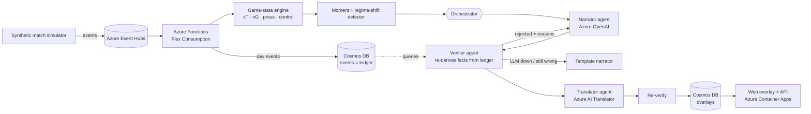

# Momentum Ledger

**Verified, personalized match intelligence for live football broadcasts.**

Momentum Ledger measures how much every moment changes a match, explains why it matters, **proves every claim against the raw event ledger before it goes on screen**, and tells the story differently for every fan, in any language.

Built for *Inside the Game: Developer Hackathon* (Microsoft × Premier League), challenge: **The Synthetic Match Insights Engine for Premier League Studio**. It uses only synthetic, football-realistic data.

---

## The problem

Live AI commentary is powerful, but a broadcaster can't risk it on air. One invented stat ("his 4th goal of the season" when it's his 3rd) on a live broadcast damages trust. Most match tools also report *what* happened, not *why it mattered*, and every viewer gets the same experience.

## What Momentum Ledger does

| Stage | What happens | Where |
|---|---|---|
| **Ingest** | A stochastic simulator streams football-realistic events: passes, carries, shots, tackles, interceptions, pressures, possession changes, substitutions and metadata. Team *styles* (possession, low block, high press) shape the event patterns. | `momentum/simulator.py` → Azure Event Hubs |
| **Interpret** | A live game-state engine gives every event a measured value: expected threat (xT) added, xG, danger removed, lines broken, pass difficulty, press height, control vs. chaos, and momentum. | `momentum/engine.py` |
| **Explain** | The engine narrates *moments that changed the game* and *points where the game changed character*: regime shifts in control and press, detected from data alone. | `momentum/moments.py` |
| **Verify** | Every insight is a set of **facts, each carrying the ledger query that proves it**. A verifier agent re-derives each fact from raw events and checks every number, name and claim in the text. | `momentum/ledger.py`, `agents/verifier.py` |
| **Render** | Timecoded, machine-readable overlay JSON (graphic template, priority, duration, per-language text, evidence and verification), plus a live web overlay. | `momentum/broadcast.py`, `web/` |
| **Personalize** | Casual or Analyst mode, club framing ("good news for Riverside fans" vs. "danger for Northbridge"), **Player Lens**, **Catch Me Up** (a ranked recap from your side, not a chronological log), and any language. | `agents/templates.py`, `agents/orchestrator.py` |

### The differentiator: the trust panel

```
 82' BLOCKED (injected: invented_history)
     text: GOAL! Malik Otieno scores for Riverside Athletic (82')... That's his 4th goal of the season.
     why:  unsupported number(s): 4; claim beyond this match's ledger ('season')
```

Nothing reaches the screen unless the verifier passes it:

1. **Fact audit**: each fact's query is re-run against raw events through code that is *independent* of the incremental engine. Both paths must agree. During development this caught a real engine bug.
2. **Numbers**: every number in the text must equal a verified fact, at its stated precision.
3. **Entities**: every player or club named must be involved in this moment.
4. **Scope**: no claims the ledger can't know (seasons, records, history, injuries) in English, Spanish or Swahili.
5. **LLM judge** (optional): an Azure OpenAI check for meaning-level contradictions.

A rejected draft goes back to the narrator with the verifier's reasons. If the LLM is down or still wrong, the deterministic template narrator takes over. If nothing verifies, the insight is suppressed. Translations are verified again, so every language inherits the grounding.

> **Demo fault injection.** With `DEMO_INJECT_FAULTS=true`, a share of first drafts is deliberately corrupted (an invented season stat, a wrong number, a wrong player) so judges can watch the verifier work. Every injected fault is labelled in the UI and logs; nothing is passed off as organic.

### The planted storyline (detected, not scripted)

The demo match (seed 7) has a dominant home first half, then the away side switches to a high press just before the hour, and a late comeback follows. **The style switch is never emitted as an event.** The engine finds it:

> **62' Tactical shift**: Riverside Athletic press up 36 m (25 → 61 m from own goal) · Northbridge FC passes per possession 8.3 → 4.2 over the last 8

---

## Architecture



* **Stateless and idempotent**: the Function rebuilds state by replaying the ledger, so it survives crashes and at-least-once delivery. Overlay ids are deterministic, so upserts never duplicate.
* **Time-bounded queries**: every fact's query is bounded by match time, so any overlay can be re-audited later with the same result.
* **Graceful degradation**: every Azure service is optional. With nothing configured, the whole system runs offline.

## Quick start (offline, about 1 minute)

```bash
python3 -m venv .venv && source .venv/bin/activate
pip install -r requirements-dev.txt
python -m momentum serve          # open http://localhost:8000
```

In the UI: pick a mode, club, Player Lens and language, then **▶ Watch live**. Try **Join at minute 63** + **Catch me up**, and **Multiview** to see three viewers get three different verified experiences of the same moment.

CLI:

```bash
python -m momentum simulate --out data/match.json   # write the synthetic dataset
python -m momentum narrate --persona analyst --club away --lang es
python -m momentum narrate --json                    # overlay JSON for a graphics partner
python -m momentum trust                             # every blocked draft and why
pytest                                               # 39 tests
```

## Running on Azure

```bash
cp .env.example .env    # fill in whichever services you have
./scripts/deploy.sh     # Bicep: Event Hubs, Cosmos DB, Azure OpenAI, Translator, Functions, Container Apps
python -m momentum publish --speed 30   # stream a match into Event Hubs
```

| Variable | Enables |
|---|---|
| `AZURE_OPENAI_ENDPOINT`, `AZURE_OPENAI_DEPLOYMENT` (+ key, or Entra ID) | LLM narrator and judge (works with Microsoft Foundry deployments) |
| `AZURE_TRANSLATOR_KEY`, `AZURE_TRANSLATOR_REGION` | Any language: fr, pt, ar, hi, yo, zh-Hans… |
| `EVENTHUB_CONNECTION`, `EVENTHUB_NAME` | Real-time ingest |
| `COSMOS_ENDPOINT` (+ key, or Entra ID) | Durable ledger and overlay store |
| `VERIFIER_LLM_JUDGE=true` | Adds the meaning-level LLM check |

## Overlay output

```json
{
  "type": "overlay",
  "insight_id": "story-press-61",
  "kind": "tactical_story",
  "graphic": "tactical_panel",
  "priority": 3,
  "trigger": { "t": 3660.0, "match_clock": "61:00", "timecode": "01:01:00:00", "minute": 62 },
  "duration_s": 10.0,
  "profile": { "persona": "analyst", "club": null, "player_id": null, "lang": "en" },
  "text": "Tactical shift · Riverside Athletic press up 36 m (25 → 61 m from own goal) · ...",
  "data": { "press_change_m": "36", "passes_recent": "4.2", "passes_before": "8.3", "...": "..." },
  "verification": { "status": "verified", "checks": [ { "name": "facts", "ok": true, "detail": "11 facts re-derived from 1853 raw events" } ] }
}
```

## Repository map

```
momentum/
  simulator.py      synthetic match generator (styles, storyline director)
  pitch.py          xT, xG, defensive lines, pass difficulty
  engine.py         incremental game state and event values
  ledger.py         append-only event store + query language (the source of truth)
  moments.py        key moments, regime shifts, player cards -> verifiable facts
  agents/           narrator, verifier, translator, fault injector, orchestrator, templates
  broadcast.py      director (who sees what), overlay JSON, live sessions, catch-up
  server.py         FastAPI: SSE stream, catch-up, overlay export
  azure_io.py       Event Hubs + Cosmos DB adapters
functions/          Azure Functions (Event Hubs trigger -> verified overlays in Cosmos)
infra/main.bicep    Azure infrastructure
web/                live overlay UI (pitch, graphics, trust panel, multiview)
data/               sample synthetic match (seed 7)
tests/              simulator, engine/ledger agreement, verifier, API
```

## Data

All data is synthetic and generated by `momentum/simulator.py`. Teams and players are fictional. No real Premier League data is used or redistributed. `data/match_seed7.json` is the demo match. Any seed produces a new, reproducible match.
