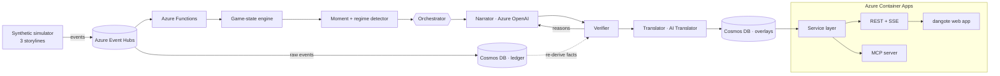

<div align="center">

# dangote_

**Every number on screen, proven.**

Verified, personalized football match intelligence. Synthetic events in; an AI production crew that
measures every moment, explains why it matters, **proves every claim against the raw event ledger before
it goes on air**, and tells the story differently for every fan, in any language.

*Built for **Inside the Game: Developer Hackathon** (Microsoft × Premier League)*
*Challenge: The Synthetic Match Insights Engine for Premier League Studio*

`Python` · `FastAPI` · `React 19` · `TypeScript` · `Azure OpenAI` · `AI Translator` · `Event Hubs` · `Functions` · `Cosmos DB` · `Container Apps` · `MCP`

</div>

---

## Contents

1. [The problem](#the-problem)
2. [What it does](#what-it-does)
3. [The studio](#the-studio)
4. [How verification works](#how-verification-works)
5. [Architecture](#architecture)
6. [Repository structure](#repository-structure)
7. [Quick start](#quick-start)
8. [API](#api)
9. [MCP: the studio as tools](#mcp-the-studio-as-tools)
10. [Running on Azure](#running-on-azure)
11. [Performance](#performance)
12. [Testing](#testing)
13. [Data](#data)

---

## The problem

Live AI commentary is powerful, but a broadcaster can't risk it on air. **One invented stat** ("his 4th
goal of the season" when it's his 3rd) on a live broadcast damages trust. Most match-data tools also
report *what* happened, not *why it mattered*, and every viewer gets the same experience.

## What it does

| Stage | What happens |
|---|---|
| **Ingest** | A seeded simulator plays 90 minutes of football-realistic events: passes, carries, shots, tackles, interceptions, pressures, possession changes, substitutions. Each team's **tactical style** (possession, low block, high press) shapes the event patterns. |
| **Interpret** | A live engine gives every event a measured value: expected threat (xT) added, xG, danger removed, lines broken, pass difficulty, ball/shot/player speed, press height, control vs. chaos, momentum. |
| **Explain** | It surfaces the **moments that changed the game** and the **points where the game changed character** (regime shifts in control and press), detected from data alone. The style switches are never emitted as events. |
| **Verify** | Every insight is a set of facts, each carrying the **ledger query that proves it**. A verifier agent re-derives every number from raw events before anything airs. |
| **Render** | Timecoded, machine-readable overlay JSON (graphic template, priority, duration, per-language text, evidence, verification), played on a live control room. |
| **Personalize** | Casual / Analyst · club framing · Player Lens · Catch Me Up · English, Spanish, Swahili offline, any language with Azure AI Translator. |

### Three storylines

| Scenario | Match | What the engine has to discover |
|---|---|---|
| **The Press Trap** | Northbridge FC 1-2 Kilima Rangers | Kilima switch to a high press at 56'. At 62' the engine reports *"press up 36 m, Northbridge passes per possession 8.3 → 4.2"*, then the comeback. |
| **The Late Show** | Coastline FC 2-0 Highveld Athletic | 75 minutes against a low block, then Coastline go all in; the press shift is detected at 78'. |
| **End to End** | Highveld Athletic 3-3 Kilima Rangers | Two pressing sides, six goals, a brace each way. |

## The studio

The web app (`frontend/`) is a broadcast control room:

| Tab | What's in it |
|---|---|
| **Control room** | Rundown of aired moments (replay from any of them), a **3D broadcast monitor** with all 22 players (tactical, follow-ball and click-to-follow player cameras) plus a **Territory** view (who controlled which zones in the last 10'), on-air graphics, live ticker, momentum / possession / chaos / xG meters, viewer modes, and an **Insight desk** showing the facts and checks behind each line. A transport bar plays, pauses, scrubs and jumps to goals at 10–120×. |
| **Match pack** | Average-position lineups, live team stats, shot map (area = xG), **xG race** and **momentum river** charts, and a sortable player table, all recomputed for the current minute. |
| **Trust lab** | The verification pipeline with live counts, the full trust log (every blocked draft and why), and the **Fact-check desk**: paste any sentence, pick a minute, and see every number traced to a fact, or flagged. |
| **Developers** | Every REST endpoint runnable in an in-page console, the MCP config to copy, and the tool list. |

Also: **Compare 3 viewers** (three verified tellings of the same match, synced to the clock), keyboard
control (space, ←/→, 1–4), and deep links (`?scenario=press-trap&t=62&club=away&lang=sw&autoplay=1`).
Typography is Consolas throughout (Inconsolata where Consolas isn't installed).

## How verification works

An insight is never prose. It is a set of facts, and every fact carries the query that proves it:

```json
{ "key": "passes_recent", "value": 4.2, "display": "4.2",
  "query": { "op": "poss_passes_mean", "side": "home", "t1": 3660.0, "last_n": 8 } }
```

| Check | Rule |
|---|---|
| **Fact audit** | Re-runs each fact's query against raw events through code independent of the live engine. Both must agree. |
| **Numbers** | Every number in the text equals a verified fact at its stated precision. |
| **Entities** | Every player or club named is involved in this moment. |
| **Scope** | No claims the ledger can't know: seasons, records, history, injuries (en / es / sw). |
| **LLM judge** *(optional)* | Azure OpenAI checks for meaning-level contradictions. |

```
personalize ─► Narrator (Azure OpenAI) ─► Verifier ──ok──► Translator ─► re-verify ─► ON AIR
                    ▲                        │                               │
                    └──── reasons ◄──────────┘ retry once                    └─ fail → verified source text
               Template narrator ◄── LLM down or still rejected
               Suppressed        ◄── nothing verifiable (never shown)
```

The **Fact-check desk** applies the same idea to free text: each clause's numbers must match a fact of
the player or club it names, at the chosen minute ("Callum Shaw has 2 goals" → unsupported; he has 1).

> **Demo fault injection.** With `DEMO_INJECT_FAULTS=true`, a share of first drafts is deliberately
> corrupted (invented season stat, wrong number, wrong player) so you can watch the verifier work.
> Every injected fault is labelled. Turn it off for production.

## Architecture



- **One service layer** (`backend/dangote/service.py`) backs the REST API, the MCP tools and the web app, so what an agent queries is exactly what a viewer sees.
- **Deterministic and cacheable**: (scenario, seed, viewer) fully determines every byte, so results are cached and re-auditable.
- **Graceful degradation**: every Azure service is optional; with none configured, everything runs offline.

## Repository structure

```
├── backend/
│   ├── dangote/
│   │   ├── simulator.py     seeded match engine
│   │   ├── scenarios.py     storylines + fictional clubs
│   │   ├── pitch.py         xT, xG, defensive lines, pass difficulty
│   │   ├── engine.py        incremental game state
│   │   ├── ledger.py        event store + query language (source of truth)
│   │   ├── moments.py       moments and regime shifts → verifiable facts
│   │   ├── agents/          narrator, verifier, translator, faults, orchestrator, templates
│   │   ├── broadcast.py     director, overlay JSON, live sessions, catch-up
│   │   ├── service.py       one service layer for REST, MCP and the web app
│   │   ├── factcheck.py     fact-check any sentence against the ledger
│   │   ├── mcp.py           MCP server (Streamable HTTP)
│   │   ├── server.py        FastAPI app
│   │   └── azure_io.py      Event Hubs + Cosmos DB
│   ├── tests/               51 tests
│   ├── data/                the three storylines as JSON
│   ├── functions/           Azure Functions (Event Hubs → verified overlays in Cosmos)
│   ├── infra/main.bicep     every Azure resource
│   └── scripts/deploy.sh    provision + deploy
├── frontend/                dangote web app: React 19 + TypeScript + Vite
└── Dockerfile               one container: web app served by the API
```

## Quick start

Requires Python 3.11+ and Node.js 20+.

```bash
# 1. backend (port 8010)
cd backend
python3 -m venv .venv && source .venv/bin/activate
pip install -r requirements-dev.txt
python -m dangote serve

# 2. frontend (port 5173, second terminal)
cd frontend
npm install
npm run dev
```

Open **http://localhost:5173**: it opens straight into the control room on *The Press Trap*. Press play, or switch storyline from the picker in the header.
Single-server mode (as in production): `cd frontend && npm run build`, then the backend serves the app on :8010.

CLI:

```bash
python -m dangote simulate --scenario late-show --out data/late-show.json
python -m dangote narrate --scenario press-trap --persona analyst --club away --lang es
python -m dangote trust --scenario end-to-end      # every blocked draft and why
```

## API

| Method | Path | Returns |
|---|---|---|
| `GET` | `/api` | Service index |
| `GET` | `/api/scenarios` | The storylines |
| `GET` | `/api/matches/prepare?scenario=&persona=&club=&player=&lang=` | Everything to play a match locally: events, state timeline, verified overlays, trust log |
| `GET` | `/api/matches/summary` · `/state?minute=` · `/teams?minute=` · `/players?minute=` · `/insights` | Match intelligence |
| `GET` | `/api/matches/events.jsonl` · `/insights.csv` · `/data-card` | Dataset exports |
| `POST` | `/api/factcheck` `{scenario, minute, text}` | Verdict + each number traced to a fact |
| `GET` | `/api/catchup?minute=` | Verified recap from the viewer's side |
| `GET` | `/api/stream` | SSE: live ticks, overlays, trust records (local replay or Event Hubs) |
| `POST` | `/mcp` | MCP tools (below) |

All endpoints take `scenario` (default `press-trap`) and optional `seed`. OpenAPI docs at `/docs`.

## MCP: the studio as tools

`POST /mcp` speaks the Model Context Protocol (Streamable HTTP, stateless JSON, so the container can
scale to zero). Any MCP host can drive the studio: Azure AI Foundry agents, GitHub Copilot, VS Code, Claude.

```json
{ "mcpServers": { "dangote": { "type": "http", "url": "http://localhost:8010/mcp" } } }
```

| Tool | Does |
|---|---|
| `list_scenarios` | The storylines and clubs |
| `match_summary` | Score, goals, headline moments with their proofs |
| `match_state_at` | State and team stats at a minute |
| `query_events` | Raw events by type, team, player, minute range |
| `query_insights` | Detected moments with facts and ledger queries |
| `player_stats` | Per-player stats and average positions at a minute |
| `fact_check` | Verify any sentence against the ledger |
| `catch_up` | Verified recap from a viewer's side |
| `render_overlays` | Verified, timecoded overlays for a viewer profile |

## Running on Azure

```bash
cp backend/.env.example backend/.env    # optional: point local runs at Azure services
./backend/scripts/deploy.sh             # Bicep: Event Hubs, Cosmos DB, Azure OpenAI, Translator, Functions, Container Apps
cd backend && python -m dangote publish --scenario press-trap --speed 30
```

| Azure service | Role | Enabled by |
|---|---|---|
| **Azure OpenAI** (Foundry deployment) | Narrator agent, LLM judge | `AZURE_OPENAI_ENDPOINT`, `AZURE_OPENAI_DEPLOYMENT` |
| **Azure AI Translator** | Any language, names kept verbatim | `AZURE_TRANSLATOR_KEY`, `AZURE_TRANSLATOR_REGION` |
| **Azure Event Hubs** | Real-time ingest | `EVENTHUB_CONNECTION` |
| **Azure Functions** (Flex Consumption) | Event-driven processing, stateless replay | `backend/functions/` |
| **Azure Cosmos DB** (serverless) | Ledger + overlay store | `COSMOS_ENDPOINT` |
| **Azure Container Apps** | Web app + API + MCP, scale to zero | `Dockerfile` |

## Performance

- **Web**: ~80 KB gzipped first load; Match pack, Trust lab and Developers are code-split. Playback runs on a local clock (pause, scrub, speed changes are instant); the clock re-renders at most 30×/s; every derived value is a binary search or one pass over the events.
- **API**: match pack 60–200 ms cold, ~15 ms cached; config ~1 ms; orjson + gzip; uvloop/httptools; the default storyline warms at startup.

## Testing

```bash
cd backend && pytest          # 51 tests
cd frontend && npm run build  # strict TypeScript + production build
```

Covers: simulator determinism and storylines; engine-vs-ledger agreement for every fact in every
storyline; verifier blocking (invented history, wrong numbers, wrong players, forged facts); every
template line verifying in every language, persona and club; fact-check verdicts (including "not yet
true at this minute"); MCP handshake and tools; API and dataset exports.

## Data

All data is **synthetic**: fictional clubs and players, generated from a seed. **No real Premier League
data is used.** `backend/data/` holds the three storylines; `/api/matches/data-card` documents schema
and provenance.
