<div align="center">

# dangote_

### Every number on screen, proven.

AI match intelligence for live football broadcasts. dangote measures every moment, explains why it
matters, **proves every claim against the raw event ledger before it goes on air**, and tells the same
verified story differently for every fan, in any language.

**[▶ Live demo](https://gregory-bot.github.io/momentum_ledger/)** ·
**[🎬 Demo video (1:42)](docs/media/dangote-demo.mp4)** ·
**[How we use Azure](#how-we-use-microsoft-azure)** ·
**[Run it](#quick-start)**

[](https://github.com/gregory-bot/momentum_ledger/actions/workflows/ci.yml)
[](https://gregory-bot.github.io/momentum_ledger/)

*Built for the **Inside the Game: Developer Hackathon** (Microsoft × Premier League)*
*Challenge: **The Synthetic Match Insights Engine for Premier League Studio***

<a href="docs/media/dangote-demo.mp4">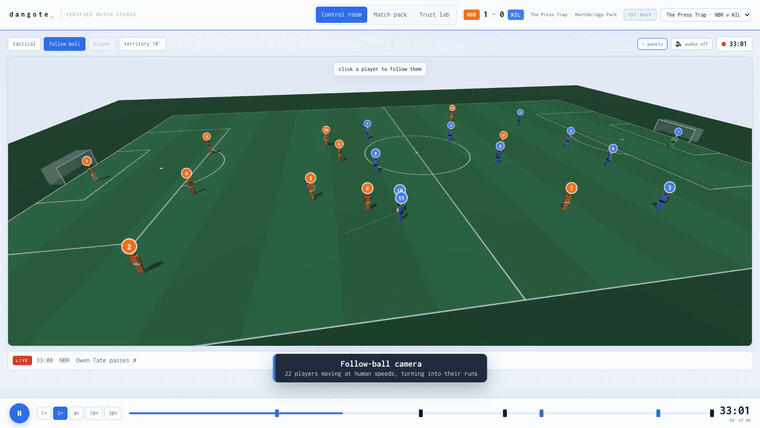</a>

`Azure OpenAI` · `Azure AI Translator` · `Event Hubs` · `Azure Functions` · `Cosmos DB` · `Container Apps` · `Bicep` · `MCP` · `Python` · `FastAPI` · `React` · `TypeScript` · `three.js`

</div>

---

## Contents

1. [The problem](#the-problem)
2. [What dangote does](#what-dangote-does)
3. [Screens](#screens)
4. [How we use Microsoft Azure](#how-we-use-microsoft-azure)
5. [How verification works](#how-verification-works)
6. [Architecture](#architecture)
7. [Quick start](#quick-start)
8. [Hosting and deployment](#hosting-and-deployment)
9. [API and MCP server](#api-and-mcp-server)
10. [Judging criteria](#judging-criteria)
11. [Repository structure](#repository-structure)
12. [Testing and quality](#testing-and-quality)
13. [Data](#data)

---

## The problem

Live AI commentary is powerful, but **a broadcaster can't risk it on air**. One invented stat ("his 4th
goal of the season" when it's his 3rd) on a live broadcast damages trust that took years to build. Most
match-data tools also report *what* happened, not *why it mattered*, and every viewer gets the same
experience whether they're an analyst, a casual fan, or a supporter watching in Kiswahili.

## What dangote does

One pipeline, five stages, exactly as the challenge describes:

| Stage | What happens |
|---|---|
| **1 · Ingest** | A seeded simulator plays 90 minutes of football-realistic events (passes, carries, shots, tackles, interceptions, pressures, possession changes, substitutions). Each team's **tactical style** (possession, low block, high press) shapes the event patterns. Locally it replays; on Azure it streams through **Event Hubs**. |
| **2 · Interpret** | A live engine gives every event a measured value: expected threat (xT) added, xG, danger removed, lines broken, pass difficulty, ball/shot/player speed, press height, control vs. chaos, and momentum. |
| **3 · Explain** | It surfaces the **moments that changed the game** and the **moments the game changed character**: regime shifts in control and pressing, detected **from the data alone** (style switches are never emitted as events). |
| **4 · Verify & render** | Every insight is a set of facts that each carry the **ledger query that proves them**. The narrator agent (**Azure OpenAI**) writes the line; a verifier agent re-derives every number and name from raw events; failures are blocked and rewritten. Output is timecoded, machine-readable overlay JSON. |
| **5 · Personalize** | Casual or analyst · club framing · **Player Lens** · **Catch Me Up** · any language (**Azure AI Translator**; English, Spanish and Kiswahili built in), and a **commentator voice** that reads verified lines aloud. |

**Three storylines**, each with a tactical story the engine has to discover on its own:

| Storyline | Match | What the engine finds |
|---|---|---|
| **The Press Trap** | Northbridge FC 1-2 Kilima Rangers | Kilima switch to a high press at 56'. By 59' the engine reports Kilima pressing 30 m higher and Northbridge's passes per possession collapsing, then the comeback. |
| **The Late Show** | Coastline FC 2-0 Highveld Athletic | 75 minutes against a low block, then Coastline go all in; the press shift is detected at 75'. |
| **End to End** | Highveld Athletic 3-3 Kilima Rangers | Two pressing sides, six goals, a brace each way. |

## Screens

<table>
<tr>
<td width="50%">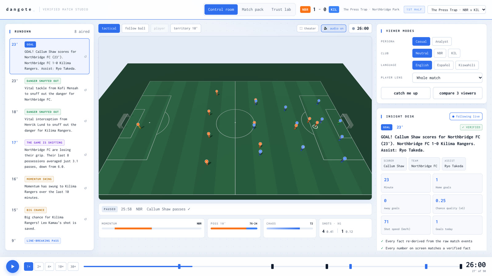<br><b>Control room.</b> Rundown of verified moments, the 3D broadcast monitor, viewer modes, and the Insight desk showing the facts and checks behind the selected line.</td>
<td width="50%">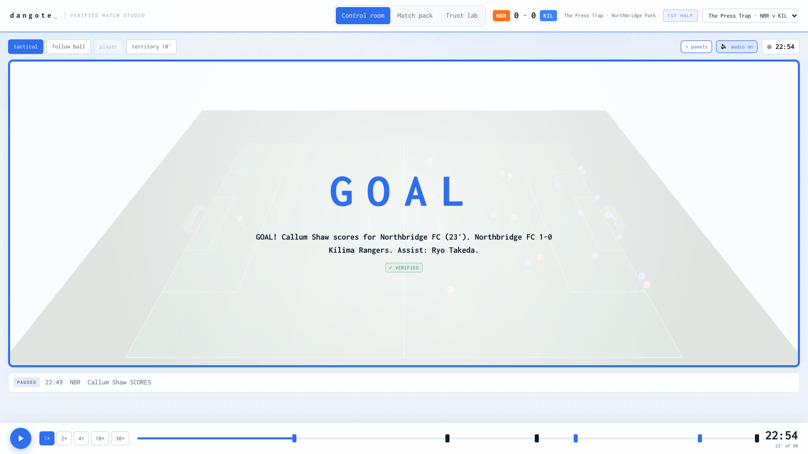<br><b>A goal, verified before air.</b> Score, minute, xG and names are re-derived from the raw events before the graphic is allowed on screen.</td>
</tr>
<tr>
<td>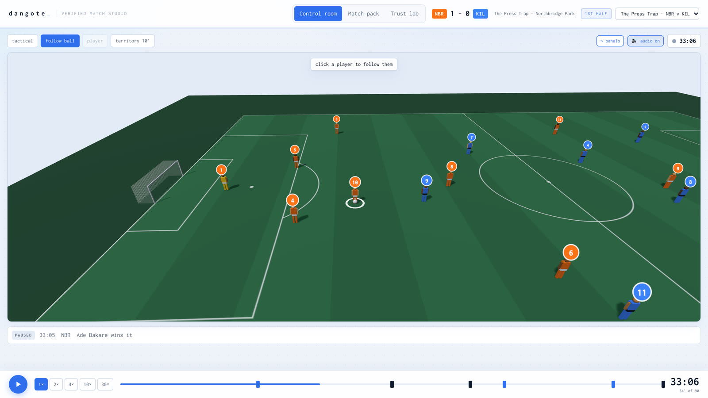<br><b>Follow-ball camera.</b> All 22 players move at human speeds and run with their kit, number and shadow. Click any player to follow them.</td>
<td>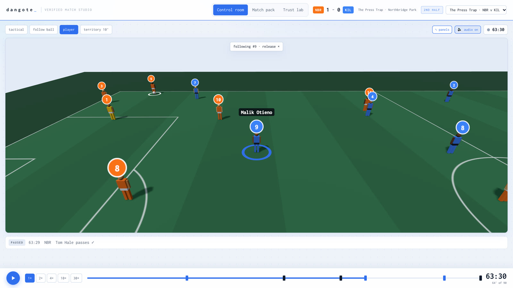<br><b>Player Lens.</b> The camera locks on one player (here Malik Otieno) for the whole match.</td>
</tr>
<tr>
<td>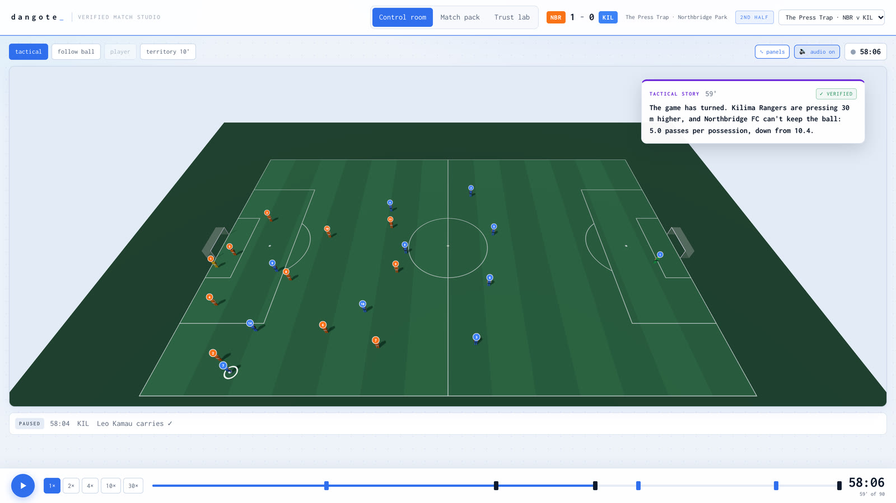<br><b>Tactical story.</b> Nobody tells the engine Kilima changed tactics; it detects the press from the data and explains why the game turned.</td>
<td>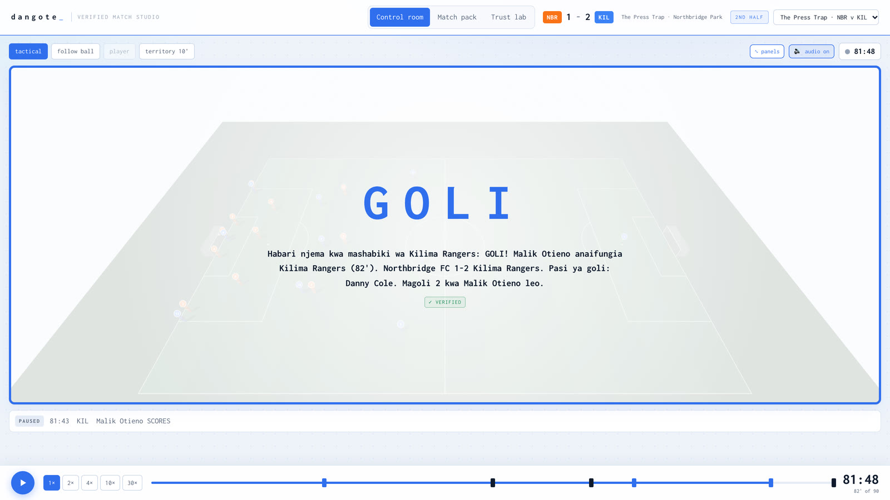<br><b>Personalized.</b> The same verified goal, framed for a Kilima Rangers fan, in Kiswahili.</td>
</tr>
<tr>
<td>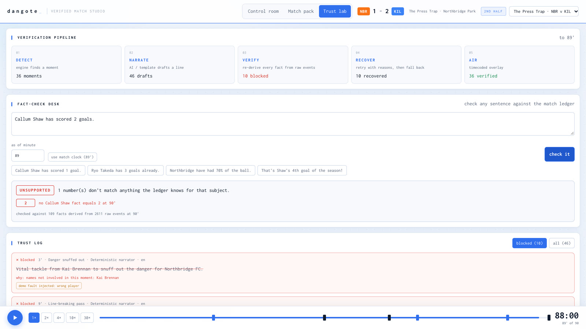<br><b>Trust lab.</b> The verification pipeline, every blocked AI draft and why, and the <b>fact-check desk</b>: "Callum Shaw has scored 2 goals" → <i>unsupported</i> (he has 1).</td>
<td>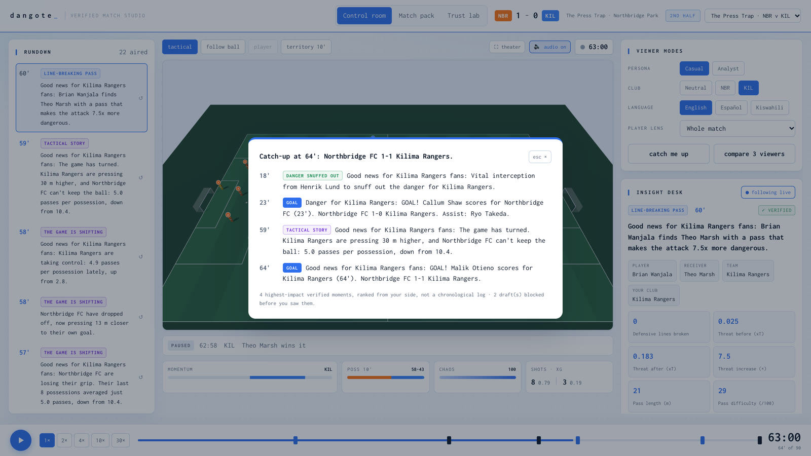<br><b>Catch me up.</b> Joined late? The highest-impact verified moments so far, told from your club's side.</td>
</tr>
<tr>
<td>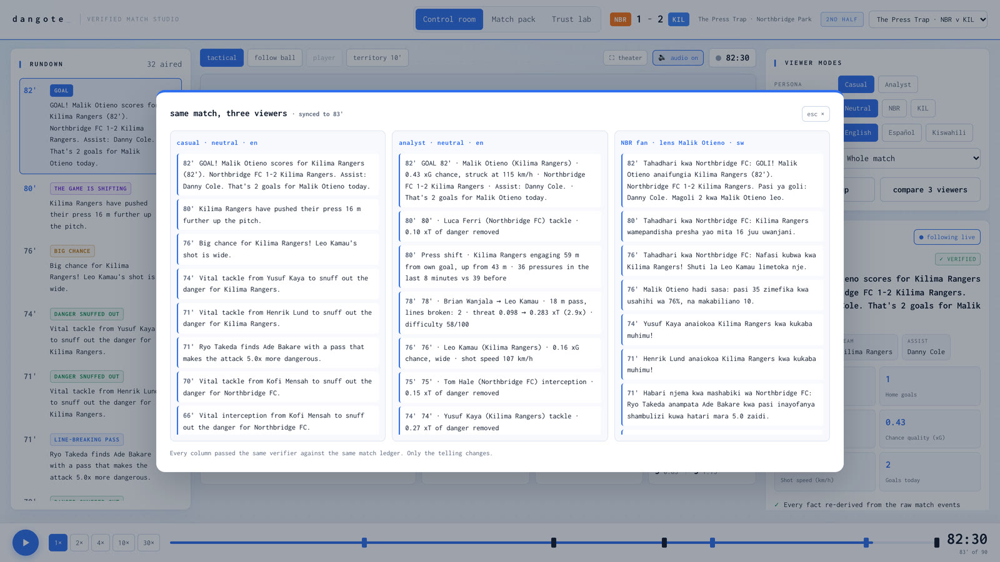<br><b>Compare 3 viewers.</b> A casual fan, an analyst and a Northbridge fan in Kiswahili: three tellings of one match, one verifier, one ledger.</td>
<td>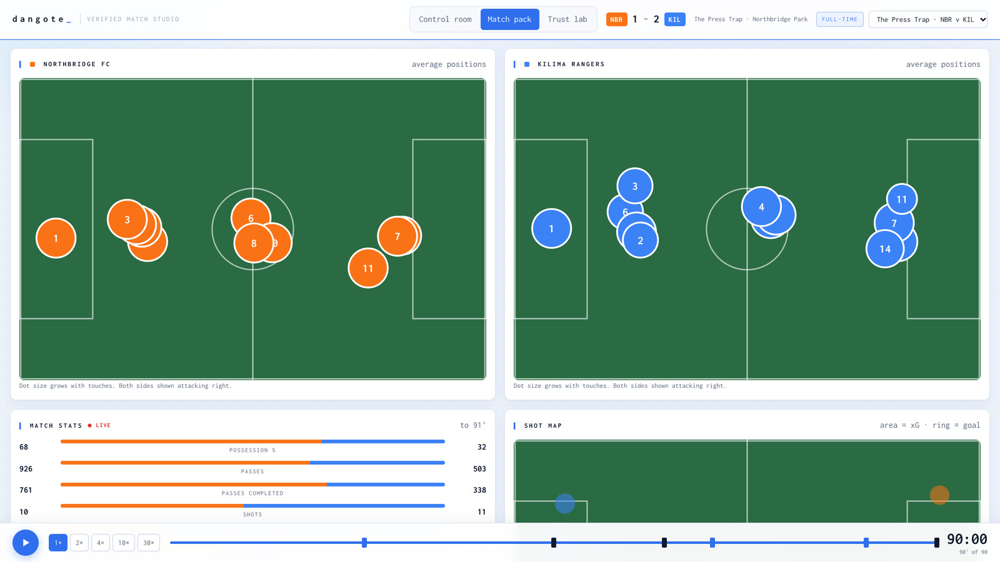<br><b>Match pack.</b> Average-position lineups, live stats, shot map, xG race, momentum river and a sortable player table.</td>
</tr>
</table>

<p align="center">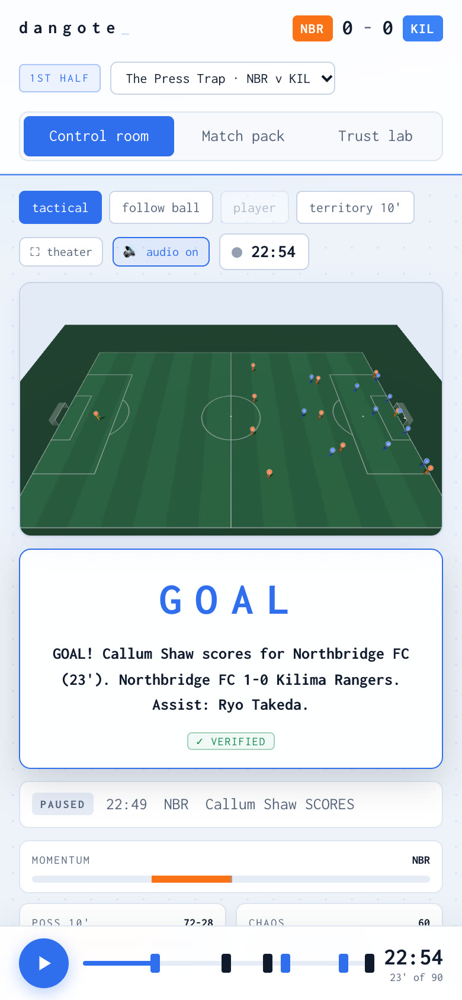<br><b>Mobile.</b> On phones the graphics sit under the pitch so they never hide the play.</p>

**Also:** a commentator voice and stadium sound (crowd, kicks, whistles, goal roar) when you press play ·
theater mode (⛶) · territory view · scrubbing with goal markers at 1×–30× · keyboard (space, ←/→, 1–3) ·
deep links such as `?scenario=press-trap&t=62&club=away&lang=sw&view=theater&cam=ball`.

## How we use Microsoft Azure

dangote is designed as an Azure-native, event-driven system. Every Azure service plugs in through
environment variables, and the app **degrades gracefully** without them (templates instead of the LLM,
local replay instead of Event Hubs), so it always runs, and switches on each Azure capability as it's
configured.

| Microsoft / Azure | What it does in dangote | Where |
|---|---|---|
| **Azure OpenAI** (deployed via **Microsoft Foundry**) | The **narrator agent** writes each on-air line from verified facts, persona-aware and grounded; it retries with the verifier's reasons when blocked. An optional **LLM judge** checks meaning-level contradictions. It also translates when Translator isn't configured. Keyless auth with **Microsoft Entra ID** (`DefaultAzureCredential`) is supported. | `backend/dangote/llm.py`, `agents/narrator.py`, `agents/verifier.py` |
| **Azure AI Translator** | Takes verified lines into any language, with player and club names protected from translation; every translation is **verified again** before air. | `agents/translator.py` |
| **Azure Event Hubs** | Real-time ingest of the synthetic event stream (`python -m dangote publish`); the live SSE stream can consume it directly. | `azure_io.py`, `server.py` (`/api/stream?source=eventhubs`) |
| **Azure Functions** (Flex Consumption) | Event-driven processing: an Event Hubs trigger stores events, replays the ledger statelessly (idempotent under at-least-once delivery), and writes verified overlays. Also an HTTP endpoint serving overlays. | `backend/functions/function_app.py` |
| **Azure Cosmos DB** (serverless) | The **event ledger** (source of truth for verification) and the overlay store, partitioned by match. | `azure_io.py` |
| **Azure Container Apps** | Hosts the whole app (API, MCP endpoint and web UI) as one container behind HTTPS, scaling to zero. | `Dockerfile`, `backend/scripts/deploy-containerapp.sh` |
| **Bicep** + **Application Insights** + **Log Analytics** | Infrastructure as code for the full footprint, with telemetry. | `backend/infra/main.bicep`, `backend/scripts/deploy.sh` |
| **Model Context Protocol** | The studio as **9 MCP tools** over Streamable HTTP, so **Foundry agents, GitHub Copilot and VS Code** can query matches and fact-check claims. | `backend/dangote/mcp.py` |
| **GitHub** (Actions + Pages) | CI (tests + strict type-check) on every push, and continuous deployment of the web app to GitHub Pages. | `.github/workflows/` |

## How verification works

An insight is never prose. It is a set of facts, and every fact carries the query that proves it:

```json
{ "key": "passes_recent", "value": 4.2, "display": "4.2",
  "query": { "op": "poss_passes_mean", "side": "home", "t1": 3660.0, "last_n": 8 } }
```

| Check | Rule |
|---|---|
| **Fact audit** | Re-runs every fact's query against raw events through code independent of the live engine. Both must agree. |
| **Numbers** | Every number in the text equals a verified fact at its stated precision. |
| **Entities** | Every player or club named is involved in this moment. |
| **Scope** | No claims the ledger can't know: seasons, records, history, injuries (en / es / sw). |
| **LLM judge** *(optional)* | Azure OpenAI checks for meaning-level contradictions. |

```
personalize ─► Narrator (Azure OpenAI) ─► Verifier ──ok──► Translator (Azure AI) ─► re-verify ─► ON AIR
                    ▲                        │                                          │
                    └──── reasons ◄──────────┘ retry                                    └─ fail → verified source text
               Template narrator ◄── LLM unavailable or still rejected
               Suppressed        ◄── nothing verifiable (never shown)
```

The **fact-check desk** applies the same idea to any sentence: each clause's numbers must match a fact
for the stat and the player or club it names, at the chosen minute.

> **Demo fault injection.** `DEMO_INJECT_FAULTS=true` deliberately corrupts a share of first drafts
> (invented season stat, wrong number, wrong player) so you can watch the verifier block them. Every
> injected fault is labelled in the Trust lab. Turn it off in production.

## Architecture

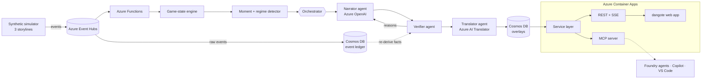

- **One service layer** (`backend/dangote/service.py`) backs the REST API, the MCP tools and the web app, so what an agent queries is exactly what a viewer sees.
- **Deterministic and re-auditable**: (storyline, seed, viewer) fully determines every byte, and every query is bounded in match time, so any overlay can be verified again later.
- **Multi-agent with recovery**: narrator → verifier → translator, coordinated by an orchestrator with retries, feedback loops and fallbacks; every step lands in the trust log.

## Quick start

Requires Python 3.11+ and Node.js 20+.

```bash
# backend: API + MCP on http://localhost:8010
cd backend
python3 -m venv .venv && source .venv/bin/activate
pip install -r requirements-dev.txt
python -m dangote serve

# frontend: http://localhost:5173 (second terminal)
cd frontend
npm install
npm run dev
```

It opens straight into the control room on *The Press Trap*. **Press play** (the commentator starts
talking), switch storyline from the header, and try the cameras, theater mode, viewer modes, *catch me
up*, *compare 3 viewers*, and the Trust lab's fact-check desk.

Optional: copy `backend/.env.example` to `backend/.env` and add Azure keys to switch on the Azure OpenAI
narrator and Azure AI Translator locally.

## Hosting and deployment

| Target | What you get | How |
|---|---|---|
| **GitHub Pages** | The full web app, playing a **pre-verified export** produced by the real pipeline. No server needed; only the free-text fact-check needs the live API. | Automatic on every push to `main` (`.github/workflows/pages.yml`). Live at **https://gregory-bot.github.io/momentum_ledger/** |
| **Azure Container Apps** (recommended) | Web app + REST API + MCP endpoint + fact-check, one HTTPS URL, scales to zero. Image built in Azure, no local Docker needed. | `az login` then `./backend/scripts/deploy-containerapp.sh` |
| **Full Azure footprint** | Event Hubs → Functions → Cosmos DB, Azure OpenAI, Translator, Container Apps, App Insights. | `./backend/scripts/deploy.sh` (Bicep in `backend/infra/main.bicep`), then `python -m dangote publish --speed 30` |
| **Any Docker host** | Same single container. | `docker build -t dangote . && docker run -p 8000:8000 dangote` |

To point the GitHub Pages site at a live API (enabling the fact-check desk there too):
`gh variable set DANGOTE_API_URL --body "https://<your-app>.azurecontainerapps.io" && gh workflow run pages`.

Static export locally: `python -m dangote export --out ../frontend/public/static-api`, then
`VITE_STATIC=1 npm run build` in `frontend/`.

## API and MCP server

| Method | Path | Returns |
|---|---|---|
| `GET` | `/api` | Service index |
| `GET` | `/api/scenarios` | The storylines |
| `GET` | `/api/matches/prepare?scenario=&persona=&club=&player=&lang=` | Everything to play a match: events, state timeline, verified overlays, trust log |
| `GET` | `/api/matches/summary` · `/state?minute=` · `/teams?minute=` · `/players?minute=` · `/insights` | Match intelligence |
| `GET` | `/api/matches/events.jsonl` · `/insights.csv` · `/data-card` | Dataset exports |
| `POST` | `/api/factcheck` `{scenario, minute, text}` | Verdict, with each number traced to a fact |
| `GET` | `/api/catchup?minute=` | Verified recap from the viewer's side |
| `GET` | `/api/stream` | Server-sent events: live ticks, overlays, trust records (local replay or Event Hubs) |
| `POST` | `/mcp` | MCP tools (below) |

OpenAPI docs at `/docs`. **MCP** (Streamable HTTP, stateless, so it scales to zero):

```json
{ "mcpServers": { "dangote": { "type": "http", "url": "http://localhost:8010/mcp" } } }
```

`list_scenarios` · `match_summary` · `match_state_at` · `query_events` · `query_insights` ·
`player_stats` · `fact_check` · `catch_up` · `render_overlays`

## Judging criteria

| Criterion | How dangote addresses it |
|---|---|
| **Technological implementation** | Typed, tested Python and TypeScript; 51 backend tests including engine-vs-ledger agreement for every fact; strict type-checked frontend; automated motion QA; CI on every push; infrastructure as code. |
| **Agentic design & innovation** | Narrator, verifier and translator agents coordinated by an orchestrator with feedback loops, retries and fallbacks; a verifier that re-derives facts through an independent code path; an MCP server so external agents can query and fact-check. |
| **Real-world impact** | Targets the actual blocker for AI in live broadcast (trust), produces timecoded overlay JSON a graphics partner can render, and deploys to Azure with one command. |
| **User experience** | A 3D broadcast monitor with camera presets, live commentary, on-pitch graphics, plain-language proof for every line, catch-up, multi-viewer comparison, and a mobile layout. |
| **Category adherence** | Implements all five stages of the challenge on synthetic data: ingest, interpret, explain, render, personalize (persona, club, player and language). |

## Repository structure

```
├── backend/
│   ├── dangote/
│   │   ├── simulator.py · scenarios.py     seeded match engine + storylines
│   │   ├── pitch.py · engine.py            value models and live game state
│   │   ├── ledger.py                       event store + query language (source of truth)
│   │   ├── moments.py                      moments and regime shifts → verifiable facts
│   │   ├── agents/                         narrator, verifier, translator, orchestrator, templates
│   │   ├── broadcast.py · service.py       overlays, live sessions, one service layer
│   │   ├── factcheck.py · mcp.py           fact-check desk, MCP server
│   │   ├── server.py                       FastAPI (API, SSE, MCP, serves the web app)
│   │   ├── azure_io.py · llm.py            Event Hubs, Cosmos DB, Azure OpenAI
│   │   └── export_static.py                static export for GitHub Pages
│   ├── functions/                          Azure Functions app
│   ├── infra/main.bicep                    Azure infrastructure
│   ├── scripts/                            deploy-containerapp.sh · deploy.sh
│   └── tests/                              51 tests
├── frontend/                               React 19 + TypeScript + Vite + three.js (see its README)
├── docs/                                   screenshots and the demo video
├── .github/workflows/                      CI and GitHub Pages
└── Dockerfile                              one container: web app served by the API
```

## Testing and quality

```bash
cd backend && pytest            # 51 tests
cd frontend && npm run build    # strict TypeScript + production build
npm run qa:motion -- "<app url>"  # in frontend/: fails if any player exceeds human speed
```

Covered: simulator determinism and storylines; engine-vs-ledger agreement for every fact in every
storyline; verifier blocking (invented history, wrong numbers, wrong players, forged facts); every
template line verifying in every language, persona and club; fact-check verdicts (including "not yet
true at this minute" and stat-specific matching); MCP handshake and tools; API and dataset exports.

## Data

All data is **synthetic**: fictional clubs and players generated from a seed, and the same seed gives
the same match on any machine. **No real Premier League data is used or redistributed.**
`backend/data/` holds the three storylines; `/api/matches/data-card` documents schema and provenance.
